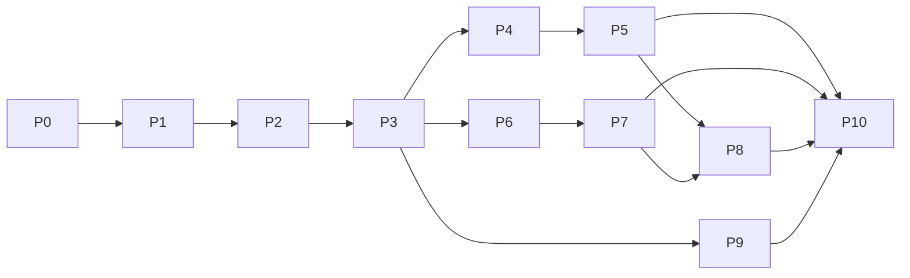

# Brainstorm: đưa Flutter đạt parity với RN mobile

Ngày: 2026-11-04. Nguồn: 4 scout đọc `su-ky-project` (apps/mobile, apps/api, docs) + repo Flutter.
Status: **đã duyệt thiết kế**. P-1 (dọn nền tảng) và P0 (xác minh API) đã xong; còn P1–P10. Chưa nối API nào.

## 1. Vấn đề
Flutter = prototype UI mock. Cần UX + chức năng + logic y RN (`apps/mobile`), style khác (Figma khác). API thật: `https://suky-api.the1struleoffightclub.top` (đã set trong `env/dev.json`).

## 2. Hiện trạng (tóm tắt)
| Khu | RN | Flutter |
|---|---|---|
| Auth | sign-in/up/out, Bearer từ `set-auth-token`, hydrate `/api/me`, 401 => xoá phiên | regex local, không API/token |
| Catalog | series, series detail, periods, events, topics | data cứng |
| Player | expo-audio, `/narrations/:id/playback`, sync bitmap, resume, đổi ngôi kể | `Timer.periodic` giả |
| Quiz | list + episode quiz + `Idempotency-Key` | chấm local, SharedPreferences |
| Missions/Honours | `/me/weekly-missions`, `/showcase/honors` | UI mock |
| Profile/History/Schedule | có | không có |
| Điều hướng | 5 tab + mini-player nổi | Widget `MainNavigation` (3 mục) vẫn do Home, Search, Missions tự nhúng; `MiniPlayer` chỉ nhúng ở Search. **Chưa có shell dùng chung**. Màn đã tự gọi `context.push/go(AppRoutes.x)`, router không còn truyền callback |
| Search | placeholder (chưa thật) | lọc in-memory |

Hạ tầng Flutter tái dùng được: `AppConfig`, `dio_factory`, `Result`/`AppException`, `AppLogger`, router, theme, l10n, connectivity. Chưa nối: secure storage (chưa có token manager). Drift có DB nhưng 0 bảng và 0 consumer (xem "Phản biện").

## 3. Quy tắc nghiệp vụ phải giữ (từ API/docs)
- Guest xem được, **không nghe**; bấm Play => login rồi quay lại đúng tập.
- Tiến độ theo `narrationId`; `playedBitmap` = 1 bit/giây, Base64; sync theo `sync.intervalMs` (>=5s), khi pause, khi hết bài. Hoàn thành khi vượt `completionThreshold` (~90%).
- Resume ưu tiên: local `pos.<narrationId>` -> server `progress.positionMs` -> 0.
- Quiz: `Idempotency-Key` UUID mỗi lần nộp; pass = score >= passingScore (mặc định 80%); XP chỉ lần pass đầu.
- Lỗi xử lý theo `error_code`, không theo `message`. Retry cùng key cho: `RATE_LIMITED`, `WRITE_CONFLICT`, 5xx...; `AUDIO_CHANGED` (409), `PROGRESS_INVALID` (422) không retry.
- Tuần mission neo thứ Hai 00:00 Asia/Ho_Chi_Minh.

## 4. Các hướng triển khai
| | A. Vertical slice (khuyến nghị) | B. Layer-first | C. Dịch nguyên cấu trúc RN |
|---|---|---|---|
| Cách làm | mỗi feature làm trọn data+domain+UI, theo thứ tự phụ thuộc | làm hết DTO/repo rồi mới UI | copy state-based nav 1 màn hình |
| Ưu | luôn chạy được, demo sớm, hợp AGENTS.md feature-first | tách lớp sạch | nhanh phác thảo |
| Nhược | cần chốt core (auth/dio) trước | lâu mới thấy UI, dễ DTO thừa | trái kiến trúc go_router/MVVM, khó test, mất deep link |

Khuyến nghị **A**. C bác bỏ: RN dùng state làm router chỉ vì Expo setup đơn giản, không phải UX cần giữ.

## 5. Kế hoạch: 10 plan, mỗi plan một mốc ổn định

Quy ước cỡ task (ước tính, chưa đo): **S** < nửa ngày, **M** nửa đến 1 ngày. Không có task **L**: task nào > 1 ngày đã bị tách. Mỗi task tự kèm test, key l10n vi+en, và không để lại mock trong phần nó thay.
**Mọi task phải tuân thủ mục "Enforced standards" trong `AGENTS.md`** (không chuỗi cứng, không màu cứng, state bất biến trong view model, mock chỉ ở `mock/` hoặc `data/mock_*`, file <= 250 dòng, màn không nhận callback điều hướng, 3 lệnh grep rỗng). Task xong khi các lệnh Verify trong `AGENTS.md` xanh.
Mỗi plan kết thúc ở trạng thái app build được, `flutter analyze` + `flutter test` xanh, chạy được trên emulator, không dở dang.

### Bản đồ phụ thuộc

Sau P3: chuỗi P4→P5, chuỗi P6→P7 và P9 độc lập nhau, giao song song được. P8 chờ cả P5 (lịch sử nghe, nút nghe) và P7 (XP, nhiệm vụ cho 8.1); P4 đã nằm trong P5.

### Kiểm kê mock UI hiện có (đối chiếu `lib/features`, `lib/shared`)
Quy ước: chức năng **chưa có mock** thì plan chứa nó mở đầu bằng một task `x.0 Dựng mock UI` (theo Figma Flutter), rồi mới nối API thật trong cùng plan. Mock dựng ở `x.0` phải được thay bằng dữ liệu thật trước khi plan đóng mốc.
| Chức năng | Mock | Ghi chú | Dựng ở |
|---|---|---|---|
| Đăng nhập | Có | `login_screen.dart` (kiểm tra regex local) | nối thật ở 1.6 |
| Đăng ký (form tên/email/mật khẩu) | **Chưa** | Chỉ có nút "Đăng ký miễn phí" gọi thông báo | 1.0 |
| Thanh tab | Có một phần | `MainNavigation` (3 mục: Khám phá, Tìm kiếm, Hồ sơ) là widget, mỗi màn tự nhúng; cần mở lên 5 mục | 2.0 (mở rộng), 2.1 (bọc thành shell) |
| Tab Hồ sơ | **Chưa** | Chưa có màn riêng, nút tab chỉ `push` sang `/login` | 2.4 (tối thiểu), 8.0a (đầy đủ) |
| Khám phá (Home) | Có | `home_screen.dart`, thời kỳ là chuỗi cứng | nối thật ở 3.6 |
| Tab Podcast (banner, carousel, tập mới) | **Chưa** | | 3.0 |
| Tìm kiếm | Có | `search_screen.dart` | nối thật ở 3.5 |
| Chi tiết Series | Có | `series_screen.dart` | nối thật ở 3.4 |
| Player (tua, tốc độ, hẹn giờ, yêu thích) | Có | `player_screen.dart` | nối thật ở 4.4 |
| Mini-player | Có (widget) | `MiniPlayer` trong `su_ke_widgets.dart` | nối thật ở 4.5 |
| Chọn ngôi kể 1/3 trên Player | **Chưa** | | 4.0 |
| Hộp thoại yêu cầu đăng nhập khi khách bấm Play | **Chưa** | | 4.0 |
| Làm quiz + kết quả + giải thích + làm lại | Có | `quiz_screen.dart` (đã tách 15 file trong `features/quiz/ui`, màn chính 132 dòng) | nối thật ở 6.4, 6.5 |
| Tab Quiz (danh sách, lọc topic, badge) | **Chưa** | | 6.0 |
| Nhiệm vụ tuần, chi tiết nhiệm vụ | Có | `weekly_missions_view_model.dart` + `domain/mission.dart`; dữ liệu mock ở `data/mock_missions.dart` | nối thật ở 7.1 (thay `MockMissions` bằng repository) |
| Vinh danh | Có | `honours_screen.dart` | nối thật ở 7.2 |
| Hồ sơ đầy đủ (XP, nhiệm vụ xong) | **Chưa** | | 8.0a |
| Lịch sử nghe | **Chưa** | | 8.0b |
| Lịch phát hành (có trạng thái rỗng) | **Chưa** | Dữ liệu thật tháng 10-11 đang rỗng | 8.0c |
| Tab Lịch sử: timeline dọc + pills thời kỳ | **Chưa** | | 9.0a |
| Chi tiết sự kiện lịch sử | **Chưa** | | 9.0b |

Đồng bộ tiến độ (P5) không có UI nên không cần mock.

### P-1. Dọn nền tảng clean-code — ĐÃ LÀM
Mốc: `dart format`, `flutter analyze`, `flutter test` xanh (69 test); đã hot restart trên emulator và kiểm tay Home và Nhiệm vụ tuần. Chưa kiểm tay Player, Quiz, Series, Honours, Search.
- 52 chuỗi cứng chuyển vào ARB (+68 key vi/en). Còn `appName = 'Sử Ký'` trong `core/config`.
- `weekly_missions`: domain bất biến + view model + mock tách riêng; `quiz_screen.dart` 926 dòng tách 15 file; không file nào > 250 dòng.
- Router không còn truyền callback điều hướng; hành vi "nghe tiếp" của chi tiết nhiệm vụ nằm trong `MissionDetailScreen`.
- Mock dữ liệu rời `AppDesign` sang `shared/mock/mock_catalog.dart`, `shared/audio/audio_defaults.dart`; màu rời rạc gom vào `*_colors.dart`.
- `HomeViewModel` là `Notifier<int>`; `quiz_attempt_codec.dart` kiểm từng trường dữ liệu lưu; thêm quy tắc chuẩn vào `AGENTS.md`.
- Còn mở: Drift chưa có consumer (cần ADR hoặc gỡ); `domain/` + `data/` của 6 feature còn lại sẽ thêm ở plan nối API.

### P0. Xác minh sự thật (spike) — ĐÃ LÀM (4/4, 0.1 còn một phần)
Mốc: biết chắc dữ kiện trước khi code. Kết quả (kiểm bằng gọi API thật + đọc code `su-ky-project`, 2026-11-04):
| # | Task | Kết quả |
|---|---|---|
| 0.1 | Sign-in | **Một phần.** Sai mật khẩu: 401 `{"message":"Invalid email or password","code":"INVALID_EMAIL_OR_PASSWORD"}` (không phải `error_code`). RN đọc token từ header `set-auth-token`, dự phòng `body.token`; body có `user{id,name,email}`. **Chưa thấy phản hồi thành công** vì chưa có tài khoản thử (không tự tạo tài khoản trên API) |
| 0.2 | Bitmap | Xem "Hợp đồng đã xác minh" bên dưới |
| 0.3 | Dữ liệu | Có 4 series publish (5 + 2 + 1 + 1 tập), 1 topic, có quiz, bảng vinh danh có 1 người. `releases` tháng 10-11 rỗng, audio demo ~32 giây |
| 0.4 | Quiz | Timer là `timeLimit` **theo từng câu** (nullable, 10-120s); RN không dùng timer; passing field là `passScorePercent` |

#### Hợp đồng đã xác minh (sửa sai lệch báo cáo scout)
- **Lỗi có hai dạng**: API dùng `{error_code, message, details?}`; endpoint `/api/auth/*` (better-auth) dùng `{message, code}`. Parser phải nhận cả hai (ảnh hưởng 1.1).
- **Bitmap**: byte `floor(sec/8)`, bit `1 << (sec % 8)` (LSB trước), base64 chuẩn có padding, độ dài `ceil(totalSeconds/8)`. Bit thừa ở byte cuối bị server tự che; bitmap dài hơn thời lượng bị 422 `PROGRESS_INVALID` (ảnh hưởng 5.1).
- **Playback**: `GET /api/narrations/{id}/playback` trả 200 **cả khi chưa đăng nhập** (`progress: null`). Chặn khách nghe là quy tắc của app theo docs/RN, không phải API ép (ảnh hưởng 4.7). Phản hồi: `audio{assetId,url,mimeType,durationMs}`, `sync{intervalMs,completionThreshold}`. URL Cloudinary tải được (206).
- **Quiz**: `GET /api/episodes/{slug}/quiz` cần đăng nhập (401 `AUTH_REQUIRED` khi khách). Quiz: `{id, episodeId, passScorePercent, questions[]}`. Thẻ catalog: `{id,title,description,episodeSlug,episodeTitle,seriesSlug,seriesTitle,topicId,topicName,posterUrl,questionCount,plays,hasCompleted}`. Kết quả nộp: `{id,quizId,scorePercent,isPassed,submittedAt,xpAwarded,totalXp,answers[{questionId,selectedOptionId,correctOptionId,isCorrect,explanation}],missions[...]}`; `optionId` trong câu trả lời có thể `null`. **Báo cáo scout ghi sai** (`score`, `passed`, `rewardXp`, `passingScore`): dùng schema thật ở `packages/shared/src/schemas/quiz-mission.ts`.
- **Honours**: trường ảnh là `image` (không phải `avatarUrl`), kèm `from`/`to`.
- **Series**: thẻ có `publishedAt`, cover có thể `null`. Phản hồi series detail có thêm `sources`, `evidenceAsOf`, `evidenceWarning`.
- **Schema nguồn sự thật**: `packages/shared/src/schemas/*.ts` (zod). DTO Flutter phải bám các file này, không bám báo cáo.

Còn mở: phản hồi `sign-in` thành công (cần một tài khoản thử từ bạn hoặc bạn đồng ý tạo bằng `sign-up`).

### P1. Mạng + Auth
Mốc: đăng nhập/đăng ký/đăng xuất thật; restart app vẫn còn phiên; 401 tự đăng xuất.
| # | Task | Cỡ |
|---|---|---|
| 1.0 | **Dựng mock UI Đăng ký** (chưa có mock): form tên/email/mật khẩu, chuyển qua lại Đăng nhập/Đăng ký, hiện/ẩn mật khẩu, trạng thái lỗi | M |
| 1.1 | Parse envelope `{error_code, message, details}` vào `AppException` (retryable theo bảng mã) | S |
| 1.2 | `TokenStore` trên `flutter_secure_storage` | S |
| 1.3 | Interceptor: gắn Bearer, đọc `set-auth-token`, 401 thì xoá phiên | M |
| 1.4 | `AuthRepository` + DTO (sign-in, sign-up, sign-out, `/api/me`) | M |
| 1.5 | `SessionController` (Riverpod): hydrate lúc khởi động, trạng thái guest/user | M |
| 1.6 | Màn đăng nhập + đăng ký nối thật (thay `login_view_model` mock) | M |
| 1.7 | ADR auth/session | S |

### P2. Khung ứng dụng (shell)
Mốc: shell dùng chung + route con + guard hoạt động; thanh tab chỉ hiển thị các tab đã có màn thật (widget 5 mục đã có nhưng tab chưa có màn thì chưa gắn route).
| # | Task | Cỡ |
|---|---|---|
| 2.0 | Mở rộng widget `MainNavigation` từ 3 lên 5 mục (Khám phá, Lịch sử, Podcast, Quiz, Hồ sơ); chỉ là widget, chưa gắn route | S |
| 2.1 | `StatefulShellRoute`: bọc `MainNavigation` + `MiniPlayer` thành shell dùng chung, **gỡ** nhúng riêng khỏi Home, Search, Missions; thanh tab chỉ hiện tab đã có màn thật | M |
| 2.2 | Khai báo route con: series, event, player, episodeQuiz, schedule, login | S |
| 2.3 | Auth guard + `returnTo` (khách bấm Play/quiz/profile thì sang login rồi quay lại) | M |
| 2.4 | **Dựng mock UI rồi nối thật tab Hồ sơ tối thiểu** (chưa có mock): tên, email, đăng xuất (từ P1) | S |

### P3. Catalog (khách duyệt được)
Mốc: khách không cần đăng nhập vẫn duyệt, tìm kiếm, xem chi tiết series thật.
| # | Task | Cỡ |
|---|---|---|
| 3.0 | **Dựng mock UI tab Podcast** (chưa có mock): banner nổi bật, carousel series, danh sách tập mới nhất, trạng thái trống/lỗi | M |
| 3.1 | DTO phân trang `{items,page,limit,total}` + Series list/detail repo | M |
| 3.2 | Episode detail repo (narrations, sources, next/prev) + Topics | M |
| 3.3 | Tab Podcast: banner nổi bật, carousel series, tập mới nhất | M |
| 3.4 | Màn Series detail: hero, danh sách tập, badge audio | M |
| 3.5 | Tìm kiếm thật `GET /api/series?q=` có debounce, thay lọc in-memory | M |
| 3.6 | Tab Khám phá: hero, pills thời kỳ (`/api/historical-periods`) | M |

### P4. Phát audio cốt lõi
Mốc: người dùng đăng nhập nghe một tập thật; tắt màn hình vẫn phát; có điều khiển ở thông báo/màn hình khóa. Chưa gửi tiến độ lên server.
| # | Task | Cỡ |
|---|---|---|
| 4.0 | **Dựng mock UI** (chưa có mock): nút chọn ngôi kể 1/3 trên Player; hộp thoại yêu cầu đăng nhập cho khách | S |
| 4.1 | Thêm `just_audio` + `just_audio_background`, manifest, `POST_NOTIFICATIONS`, init, smoke phát một URL | M |
| 4.2 | Playback repo + DTO `GET /api/narrations/{id}/playback`, map `CONTENT_UNAVAILABLE` | S |
| 4.3a | `PlaybackController`: load, play/pause, seek, ±15s, restart (một player toàn app) | M |
| 4.3b | Đổi ngôi kể (đổi narration, giữ vị trí) | S |
| 4.4 | Màn Player nối controller (thay `audio_view_model` mock) | M |
| 4.5 | Nối `MiniPlayer` (widget đã có, đang nhúng riêng ở Search) vào shell P2 và `PlaybackController`; gỡ nhúng ở `search_screen.dart` | M |
| 4.6 | Tốc độ phát + hẹn giờ ngủ | S |
| 4.7 | Cổng khách: Play thì login rồi tự phát đúng tập (`pendingPlay`) | M |
| 4.8 | Lưu tập nghe gần nhất + vị trí cục bộ (`pos.<narrationId>`) | S |
| 4.9 | ADR audio | S |

### P5. Đồng bộ tiến độ nghe
Mốc: tiến độ lên server; resume đúng; hoàn thành tập được ghi nhận.
| # | Task | Cỡ |
|---|---|---|
| 5.1 | Bitmap codec thuần, test theo mẫu của RN (phụ thuộc kết quả 0.2) | M |
| 5.2 | Progress repo `PUT /api/me/listening-progress/{id}`, xử lý 409 `AUDIO_CHANGED`, 422 `PROGRESS_INVALID` | M |
| 5.3 | Bộ lập lịch sync theo `positionStream` + `sync.intervalMs` (>=5s), khi pause, khi hết bài | M |
| 5.4 | Resume: local → server → 0 | S |
| 5.5 | Xử lý `completion` (XP, làm mới cache liên quan) | S |

### P6. Quiz
Mốc: làm quiz thật, nộp, xem kết quả và đáp án giải thích.
| # | Task | Cỡ |
|---|---|---|
| 6.0 | **Dựng mock UI tab Quiz** (chưa có mock): danh sách thẻ quiz, pills lọc topic, badge hoàn thành, trạng thái trống | M |
| 6.1 | Quiz DTO + repo (catalog `/api/quizzes`, `/api/episodes/{slug}/quiz`) | M |
| 6.2 | Nộp attempt với `Idempotency-Key` UUID, giữ nguyên key khi retry | M |
| 6.3 | Tab Quiz: danh sách, lọc theo topic, badge hoàn thành | M |
| 6.4 | Màn làm quiz nối thật (giữ timer nếu 0.4 xác nhận) | M |
| 6.5 | Màn kết quả: điểm, đạt/chưa đạt, đáp án giải thích, làm lại | M |
| 6.6 | Bỏ lưu attempt bằng `SharedPreferences` cũ | S |

### P7. Nhiệm vụ tuần + Vinh danh
Mốc: tiến độ nhiệm vụ và bảng vinh danh thật.
| # | Task | Cỡ |
|---|---|---|
| 7.1 | Missions repo + màn danh sách/chi tiết (`/api/me/weekly-missions`) | M |
| 7.2 | Honours repo + màn (`/api/showcase/honors?period=`) | S |
| 7.3 | Làm mới missions sau khi hoàn thành tập (P5) hoặc đạt quiz (P6) | S |

### P8. Hồ sơ đầy đủ, Lịch sử nghe, Lịch phát hành
Mốc: hồ sơ có XP, lịch sử có nghe tiếp, lịch phát hành theo tháng.
| # | Task | Cỡ |
|---|---|---|
| 8.0a | **Dựng mock UI Hồ sơ đầy đủ** (chưa có mock): thẻ người dùng, XP, số nhiệm vụ đã xong, đăng xuất | M |
| 8.0b | **Dựng mock UI Lịch sử nghe** (chưa có mock): danh sách tập kèm % tiến độ, lọc trạng thái, nút nghe tiếp, trạng thái trống | M |
| 8.0c | **Dựng mock UI Lịch phát hành** (chưa có mock): chuyển tháng, nhãn Đã phát hành/Sắp ra mắt, trạng thái trống | M |
| 8.1 | Hồ sơ: XP, số nhiệm vụ đã xong (cần P7) | M |
| 8.2 | Lịch sử nghe `/api/me/listening-history` (lọc trạng thái, phân trang) + nút nghe tiếp | M |
| 8.3 | Lịch phát hành `/api/showcase/releases` (chuyển tháng, giới hạn 62 ngày) + nút nghe | M |

### P9. Dòng thời gian + Sự kiện lịch sử
Mốc: tab Lịch sử lọc theo thời kỳ, mở chi tiết sự kiện và series liên quan.
| # | Task | Cỡ |
|---|---|---|
| 9.0a | **Dựng mock UI tab Lịch sử** (chưa có mock): pills thời kỳ + timeline dọc | M |
| 9.0b | **Dựng mock UI Chi tiết sự kiện** (chưa có mock): ngày, tóm tắt, trích dẫn, nút mở series | M |
| 9.1 | Events repo/DTO (`/api/historical-events`, chi tiết theo slug) | M |
| 9.2 | Tab Lịch sử: pills thời kỳ + timeline dọc | M |
| 9.3 | Màn chi tiết sự kiện: ngày, tóm tắt, trích dẫn, mở series | M |

### P10. Dọn dẹp và chốt
Mốc: không còn mock/dữ liệu cứng; tài liệu khớp.
| # | Task | Cỡ |
|---|---|---|
| 10.1 | Xoá mock còn sót: `shared/mock/mock_catalog.dart`, `weekly_missions/data/mock_missions.dart`, dữ liệu trong `audio_view_model`; test cũ không còn đúng | M |
| 10.2 | Chạy 3 lệnh grep trong `AGENTS.md` (Verify), xử lý nốt `appName` cứng; kiểm l10n vi/en | S |
| 10.3 | README (env, chạy), ADR còn thiếu (auth/session, audio, Drift) | S |
| 10.4 | Kiểm tay toàn luồng trên emulator | M |

### Phản biện (ponytail)
- **Drift đang 0 bảng và 0 consumer**: không tính năng nào ở trên cần SQLite (không offline, cache dùng bộ nhớ). Hoặc viết ADR nêu plan dùng đầu tiên, hoặc gỡ `drift`/`drift_flutter` + `core/storage` + `databaseProvider` ở P10. Gỡ phụ thuộc cần bạn duyệt.
- **Search**: RN chưa làm; ở P3.5 làm bản tối thiểu (một ô, debounce, kết quả series), không làm gợi ý/lịch sử tìm kiếm.
- **Không đưa vào**: chia sẻ, thông báo đẩy (nút rỗng bên RN), triển lãm 3D (`/api/exhibitions`), offline, yêu thích.

## 6. Quyết định đã chốt
1. **Audio**: `just_audio` + `just_audio_background` (không viết AudioHandler). ~0.5-1 ngày, rủi ro thấp-TB (manifest foreground service Android 14+, quyền `POST_NOTIFICATIONS`, gói còn beta). Dự phòng: `audio_service` + AudioHandler (+1-2 ngày).
2. **Điều hướng**: 5 tab + mini-player, `StatefulShellRoute`.
3. **Tính năng thêm**: giữ tốc độ phát + hẹn giờ ngủ (local); bỏ yêu thích (không có API).
4. **Offline/download**: ngoài phạm vi (YAGNI).

## 7. Rủi ro
- Chưa xác nhận bằng tài khoản thật: dạng token `set-auth-token`, bitmap encoding khớp (bit order) giữa RN và API. **Phải đọc `usePlayback.ts` + service API trước khi code bitmap.**
- `just_audio_background` trên Android 17 emulator: cần kiểm foreground service + `POST_NOTIFICATIONS`.
- `Idempotency-Key` phải giữ nguyên khi retry cùng một lần nộp quiz.
- Chỉ sync tiến độ online; không offline.
- Dữ liệu seed API có thể rỗng/ít: cần xác nhận có series publish thật.

## 8. Tiêu chí hoàn thành
- Đăng nhập tài khoản thật, phiên bền qua restart, 401 tự đăng xuất.
- Nghe 1 tập thật, tiến độ lên server, resume đúng, completion cộng XP.
- Nộp quiz thật, XP/mission cập nhật.
- Không còn mock/dữ liệu cứng; `dart format`, `flutter analyze`, `flutter test` xanh.

## 9. Bước tiếp
P-1 và P0 đã xong. Tiếp: **P1 (Mạng + Auth)**, lập `/ck:plan` chi tiết cho P1, rồi làm; mỗi lần một plan, chỉ qua plan sau khi mốc plan trước đạt. Cần bạn: một tài khoản thử (hoặc đồng ý dùng `sign-up`) để xác minh nốt phản hồi sign-in và các endpoint cần phiên.
