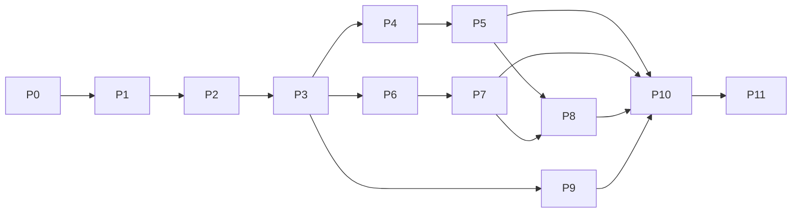

# Brainstorm: đưa Flutter đạt parity với RN mobile

Ngày: 2026-11-04. Nguồn: 4 scout đọc `su-ky-project` (apps/mobile, apps/api, docs) + repo Flutter.
Status: **đã duyệt thiết kế**. P-1, P0, P1, P2 (Khung ứng dụng), P3 (Catalog), P4 (Phát audio), P5 (Đồng bộ tiến độ nghe), P6 (Quiz), P7 (Nhiệm vụ tuần + XP), P8 (Hồ sơ, Lịch sử nghe, Lịch phát sóng) và P9 (Dòng thời gian + Sự kiện lịch sử) đã xong ở mức code (`flutter analyze` sạch trong `lib/`, build APK debug qua, chưa kiểm runtime); còn P10–P11. Auth, catalog, phát audio, tiến độ nghe, quiz, lịch sử nghe, lịch phát sóng và timeline/sự kiện đã nối API thật. **Test và chạy emulator chỉ làm một lần ở P11, sau khi xong P1–P10**; ngoại lệ duy nhất là 5 test mới của P8 (xem mục 5). P9 không có test mới.

## 1. Vấn đề
Flutter = prototype UI mock. Cần UX + chức năng + logic y RN (`apps/mobile`), style khác (Figma khác). API thật: `https://suky-api.the1struleoffightclub.top` (đã set trong `env/dev.json`).

## 2. Hiện trạng (tóm tắt)
| Khu | RN | Flutter |
|---|---|---|
| Auth | sign-in/up/out, Bearer từ `set-auth-token`, hydrate `/api/me`, 401 => xoá phiên | **Đã nối thật (P1)**: `AuthRepository`, `TokenStore`, `SessionController`, `AuthInterceptor`; chưa kiểm runtime |
| Catalog | series, series detail, periods, events, topics | **Đã nối thật (P3, P9)**: series list/detail, periods, tìm kiếm `q`, "tập mới" (quét 6 series như RN), historical events (danh sách + chi tiết theo slug); topics còn thiếu |
| Player | expo-audio, `/narrations/:id/playback`, sync bitmap, resume, đổi ngôi kể | **Đã nối thật (P4, P5)**: `just_audio` + phát nền, đổi ngôi kể, resume local → server, sync bitmap và completion |
| Quiz | list + episode quiz + `Idempotency-Key` | **Đã nối thật (P6)**: tab Quiz, làm bài theo slug, nộp attempt với UUID v4, kết quả + xem lại |
| Missions | `/me/weekly-missions` chỉ hiện trong tab Hồ sơ (XP, nhiệm vụ xong, thanh tiến độ); RN không có màn vinh danh | **Đã nối thật (P7)**: `shared/missions` + màn nhiệm vụ tuần (XP, tiến độ); Vinh danh và chi tiết nhiệm vụ đã xoá |
| Profile/History/Schedule | có | **Đã nối thật (P8)**: Hồ sơ có thẻ XP + "Đã nghe gần đây"; Lịch phát sóng công khai theo tháng (dữ liệu thật đang rỗng) |
| Điều hướng | 5 tab + mini-player nổi | **Đã có shell (P2)**: `StatefulShellRoute`, `AppShell` giữ mini-player; tab hiện có: Khám phá, Lịch sử (P9), Podcast, Quiz (P6), Hồ sơ |
| Search | placeholder (chưa thật) | **Thật (P3)**: debounce 400ms, tối thiểu 2 ký tự, khớp `title` |

Hạ tầng Flutter tái dùng được: `AppConfig`, `dio_factory` (nay có `AuthInterceptor`), `Result`/`AppException` (có `ApiException`), `AppLogger`, `TokenStore` + `SessionController` (P1), router, theme, l10n, connectivity. Drift có DB nhưng 0 bảng và 0 consumer (xem "Phản biện").

## 3. Quy tắc nghiệp vụ phải giữ (từ API/docs)
- Guest xem được, **không nghe**; bấm Play => login rồi quay lại đúng tập.
- Tiến độ theo `narrationId`; `playedBitmap` = 1 bit/giây, Base64; sync theo `sync.intervalMs` (>=5s), khi pause, khi hết bài. Hoàn thành khi vượt `completionThreshold` (~90%).
- Resume ưu tiên: local `pos.<narrationId>` -> server `progress.positionMs` -> 0.
- Quiz: `Idempotency-Key` UUID v4 mỗi lượt nộp, giữ nguyên khi retry; đạt/chưa đạt lấy từ `isPassed` của server (không còn ngưỡng 80 phía client); XP chỉ lần pass đầu, nên `xpAwarded` có thể 0.
- Lỗi xử lý theo `error_code`, không theo `message`. Retry cùng key cho: `RATE_LIMITED`, `WRITE_CONFLICT`, 5xx...; `AUDIO_CHANGED` (409), `PROGRESS_INVALID` (422) không retry.
- Tuần mission neo thứ Hai 00:00 Asia/Ho_Chi_Minh.

## 4. Các hướng triển khai
| | A. Vertical slice (khuyến nghị) | B. Layer-first | C. Dịch nguyên cấu trúc RN |
|---|---|---|---|
| Cách làm | mỗi feature làm trọn data+domain+UI, theo thứ tự phụ thuộc | làm hết DTO/repo rồi mới UI | copy state-based nav 1 màn hình |
| Ưu | luôn chạy được, demo sớm, hợp AGENTS.md feature-first | tách lớp sạch | nhanh phác thảo |
| Nhược | cần chốt core (auth/dio) trước | lâu mới thấy UI, dễ DTO thừa | trái kiến trúc go_router/MVVM, khó test, mất deep link |

Khuyến nghị **A**. C bác bỏ: RN dùng state làm router chỉ vì Expo setup đơn giản, không phải UX cần giữ.

## 5. Kế hoạch: 11 plan, mỗi plan một mốc ổn định

Quy ước cỡ task (ước tính, chưa đo): **S** < nửa ngày, **M** nửa đến 1 ngày. Không có task **L**: task nào > 1 ngày đã bị tách. Mỗi task kèm key l10n vi+en và không để lại mock trong phần nó thay.
**Quy ước kiểm thử (chốt 2026-11-04): P1–P10 không viết test và không chạy emulator.** Toàn bộ test (unit, widget, script gọi API thật) và smoke trên emulator gom vào **P11**, chạy một lần sau khi xong P1–P10. Quy tắc "mỗi hành vi mới kèm test" trong `AGENTS.md` được hoãn đến P11; không xoá test hiện có, nhưng test cũ vỡ do P1–P10 (ví dụ `test/widget_test.dart` assert chuỗi lỗi đăng nhập cũ) chỉ sửa ở P11. **Ngoại lệ ở P8:** phase 4 của P8 đã viết 5 file test mới (repo history, repo/view model/screen schedule, profile), tự biên dịch và chạy riêng bằng `flutter test <file>`, đã xanh; đây là lệch khỏi quy ước, không phải mẫu để lặp lại. **P9 vi phạm quy ước này rồi được sửa (2026-11-05):** plan P9 đã đưa phase test vào và Command Code viết 4 file test; đã xoá chúng, test của P9 để P11 (11.1c). Test cũ vỡ vẫn để P11.
**Mọi task phải tuân thủ mục "Enforced standards" trong `AGENTS.md`** (không chuỗi cứng, không màu cứng, state bất biến trong view model, mock chỉ ở `mock/` hoặc `data/mock_*`, file <= 250 dòng, màn không nhận callback điều hướng). Task xong khi `dart format`, `flutter analyze` và các lệnh grep/find trong "Verify" của `AGENTS.md` sạch; `flutter test` chạy ở P11 (trừ 5 test mới của P8).
Mỗi plan kết thúc ở trạng thái app build được và `flutter analyze` sạch, không dở dang.

### Bản đồ phụ thuộc

Sau P3: chuỗi P4→P5, chuỗi P6→P7 và P9 độc lập nhau, giao song song được. P8 chờ P5 (lịch sử nghe, nút nghe) và P7 (XP, nhiệm vụ cho 8.1); cả hai đã xong, P4 đã nằm trong P5.

### Kiểm kê mock UI hiện có (đối chiếu `lib/features`, `lib/shared`)
Quy ước: chức năng **chưa có mock** thì plan chứa nó mở đầu bằng một task `x.0 Dựng mock UI` (theo Figma Flutter), rồi mới nối API thật trong cùng plan. Mock dựng ở `x.0` phải được thay bằng dữ liệu thật trước khi plan đóng mốc.
| Chức năng | Mock | Ghi chú | Dựng ở |
|---|---|---|---|
| Đăng nhập | Có (đã nối API thật ở P1) | `login_screen.dart` + `auth_form_view_model.dart` | xong ở 1.6 |
| Đăng ký (form tên/email/mật khẩu) | Có (đã nối API thật ở P1) | Cùng màn login, chuyển chế độ | xong ở 1.0 |
| Thanh tab | Có (P2) | `MainNavigation` + `AppTab` trong `AppShell`; shell gắn đủ 5 tab: Khám phá, Lịch sử (P9), Podcast, Quiz (P6), Hồ sơ | xong ở 9.2 |
| Tab Hồ sơ | Tối thiểu (P2.4) | `profile_screen.dart`: khách thấy thẻ "Đăng nhập ngay", người dùng thấy tên, email, Đăng xuất. Chưa có XP, nhiệm vụ xong | đầy đủ ở 8.0a |
| Khám phá (Home) | Thật (P3.5) | Pills thời kỳ, series, tập mới lấy từ API (`home_screen.dart`, `period_pills.dart`) | xong |
| Tab Podcast (banner, carousel, tập mới) | Thật (P3.3) | `podcast_screen.dart`, `podcast_banner.dart` | xong |
| Tìm kiếm | Thật (P3.6) | `search_screen.dart`, debounce 400 ms, tối thiểu 2 ký tự, khớp `title`; chưa có "tải thêm" | xong |
| Chi tiết Series | Thật (P3.4) | `series_screen.dart`, route `/series/:slug`; tập không có audio vẫn hiện nhưng mờ | xong |
| Player (tua, tốc độ, hẹn giờ, đổi ngôi kể) | Thật (P4) | `player_screen.dart` + widget con trên `PlaybackController`; yêu thích đã bỏ | xong |
| Mini-player | Thật (P4), nằm trong shell | `mini_player.dart`, hiện khi `hasEpisode` | xong |
| Chọn ngôi kể 1/3 trên Player | Thật (P4.0) | `player_narration_chips.dart`, chỉ hiện khi tập có > 1 ngôi | xong |
| Hộp thoại yêu cầu đăng nhập khi khách bấm Play | Thật (P4.0) | `login_required_dialog.dart` + `playFromUi` | xong |
| Làm quiz + kết quả + giải thích + làm lại | Thật (P6) | `features/quiz/{domain,data,ui}`: làm bài theo slug, nộp attempt, kết quả và xem lại; bỏ kiểm tra từng câu | xong |
| Tab Quiz (danh sách, lọc topic, badge) | Thật (P6) | `quiz_list_screen.dart` + `quiz_card.dart`; topic suy ra từ catalog, khách xem được | xong |
| Nhiệm vụ tuần | Thật (P7) | `weekly_missions_screen.dart` + `shared/missions/{domain,data}`; chi tiết nhiệm vụ đã xoá | xong |
| Vinh danh | Đã xoá (P7) | RN không có; đã bỏ màn, route, widget và key l10n | xong |
| Hồ sơ đầy đủ (XP, nhiệm vụ xong) | Thật (P8) | `profile_xp_card.dart`; bấm thẻ mở `/weekly-missions` thay vì liệt kê nhiệm vụ trong Hồ sơ | xong ở 8.1 |
| Lịch sử nghe | Thật (P8) | `shared/history` + `profile_history_section.dart`; `limit=10`, `status=all`, không lọc/phân trang | xong ở 8.2 |
| Lịch phát hành (có trạng thái rỗng) | Thật (P8) | `features/schedule`; dữ liệu thật tháng 10-11/2026 rỗng nên trạng thái trống là đường chính | xong ở 8.3 |
| Tab Lịch sử: timeline dọc + pills thời kỳ | Thật (P9) | `features/timeline` + `shared/widgets/period_pills.dart`; một trang `limit=50`, dùng `timeLabel` của server | xong ở 9.2 |
| Chi tiết sự kiện | Thật (P9) | `features/timeline/ui/event_detail_screen.dart`, route `/events/:slug` ngoài shell; tư liệu trích dẫn + series liên quan (`eventId`) | xong ở 9.3 |

Đồng bộ tiến độ (P5) không có UI nên không cần mock.

### P-1. Dọn nền tảng clean-code — ĐÃ LÀM
Mốc: `dart format`, `flutter analyze`, `flutter test` xanh (69 test); đã hot restart trên emulator và kiểm tay Home và Nhiệm vụ tuần. Chưa kiểm tay Player, Quiz, Series, Honours, Search.
- 52 chuỗi cứng chuyển vào ARB (+68 key vi/en). Còn `appName = 'Sử Ký'` trong `core/config`.
- `weekly_missions`: domain bất biến + view model + mock tách riêng; `quiz_screen.dart` 926 dòng tách 15 file; không file nào > 250 dòng.
- Router không còn truyền callback điều hướng; hành vi "nghe tiếp" của chi tiết nhiệm vụ nằm trong `MissionDetailScreen`.
- Mock dữ liệu rời `AppDesign` sang `shared/mock/mock_catalog.dart`, `shared/audio/audio_defaults.dart`; màu rời rạc gom vào `*_colors.dart`.
- `HomeViewModel` là `Notifier<int>`; `quiz_attempt_codec.dart` kiểm từng trường dữ liệu lưu; thêm quy tắc chuẩn vào `AGENTS.md`.
- Còn mở: Drift chưa có consumer (cần ADR hoặc gỡ); `domain/` + `data/` của 6 feature còn lại sẽ thêm ở plan nối API.

### P0. Xác minh sự thật (spike) — ĐÃ LÀM (4/4)
Mốc: biết chắc dữ kiện trước khi code. Kết quả (kiểm bằng gọi API thật + đọc code `su-ky-project`, 2026-11-04):
| # | Task | Kết quả |
|---|---|---|
| 0.1 | Sign-in | **Xong.** Có tài khoản thử (role `user`, lưu ở `env/accounts.local.json`, bị gitignore). Sign-in trả 200: token ở **cả** header `set-auth-token` và `body.token`; body `{redirect,token,user{id,name,email,emailVerified,image,role,...}}`. Sai mật khẩu: 401 `{"message":"Invalid email or password","code":"INVALID_EMAIL_OR_PASSWORD"}` (không phải `error_code`). `GET /api/me` + Bearer: 200 `{user{id,name,email,emailVerified,image,role},session{expiresAt}}`; token sai/thiếu: 401 `AUTH_REQUIRED`. `POST /api/auth/sign-out`: 200 `{"success":true}`, token đó sau đó 401. Đăng ký trùng email: code `USER_ALREADY_EXISTS_USE_ANOTHER_EMAIL`. Mật khẩu 8–128 ký tự, tên 2–100 (schema `auth.ts`) |
| 0.2 | Bitmap | Xem "Hợp đồng đã xác minh" bên dưới |
| 0.3 | Dữ liệu | Có 4 series publish (5 + 2 + 1 + 1 tập), 1 topic, có quiz, bảng vinh danh có 1 người. `releases` tháng 10-11 rỗng, audio demo ~32 giây |
| 0.4 | Quiz | Timer là `timeLimit` **theo từng câu** (nullable, 10-120s); RN không dùng timer; passing field là `passScorePercent` |

#### Hợp đồng đã xác minh (sửa sai lệch báo cáo scout)
- **Lỗi có hai dạng**: API dùng `{error_code, message, details?}`; endpoint `/api/auth/*` (better-auth) dùng `{message, code}`. Parser nhận cả hai (đã làm ở 1.1).
- **Bitmap**: byte `floor(sec/8)`, bit `1 << (sec % 8)` (LSB trước), base64 chuẩn có padding, độ dài `ceil(totalSeconds/8)`. Bit thừa ở byte cuối bị server tự che; bitmap dài hơn thời lượng bị 422 `PROGRESS_INVALID` (ảnh hưởng 5.1).
- **Playback**: `GET /api/narrations/{id}/playback` trả 200 **cả khi chưa đăng nhập** (`progress: null`). Chặn khách nghe là quy tắc của app theo docs/RN, không phải API ép (ảnh hưởng 4.7). Phản hồi: `audio{assetId,url,mimeType,durationMs}`, `sync{intervalMs,completionThreshold}`. URL Cloudinary tải được (206).
- **Quiz**: `GET /api/episodes/{slug}/quiz` cần đăng nhập (401 `AUTH_REQUIRED` khi khách). Quiz: `{id, episodeId, passScorePercent, questions[]}`. Thẻ catalog: `{id,title,description,episodeSlug,episodeTitle,seriesSlug,seriesTitle,topicId,topicName,posterUrl,questionCount,plays,hasCompleted}`. Kết quả nộp: `{id,quizId,scorePercent,isPassed,submittedAt,xpAwarded,totalXp,answers[{questionId,selectedOptionId,correctOptionId,isCorrect,explanation}],missions[...]}`; `optionId` trong câu trả lời có thể `null`. **Báo cáo scout ghi sai** (`score`, `passed`, `rewardXp`, `passingScore`): dùng schema thật ở `packages/shared/src/schemas/quiz-mission.ts`.
- **Series**: thẻ có `publishedAt`, cover có thể `null`. Phản hồi series detail có thêm `sources`, `evidenceAsOf`, `evidenceWarning`.
- **Schema nguồn sự thật**: `packages/shared/src/schemas/*.ts` (zod). DTO Flutter phải bám các file này, không bám báo cáo.

Không còn mục mở. Credential thử nằm ở `env/accounts.local.json` (không đưa vào `env/dev.json` vì `--dart-define-from-file` nhúng vào APK).

### P1. Mạng + Auth — ĐÃ LÀM (code xong, chưa kiểm runtime)
Mốc: đăng nhập/đăng ký/đăng xuất thật; restart app vẫn còn phiên; 401 tự đăng xuất. Đạt ở mức code: `flutter gen-l10n`, `dart format lib`, `flutter analyze` sạch trong `lib/`, các lệnh grep/find ở "Verify" rỗng. Kiểm runtime và test ở P11. Plan: `plans/261104-1800-p1-network-auth/`. ADR: `docs/adr/0003-auth-session.md`.
| # | Task | Cỡ | Trạng thái |
|---|---|---|---|
| 1.0 | **Dựng mock UI Đăng ký**: form tên/email/mật khẩu, chuyển qua lại Đăng nhập/Đăng ký, hiện/ẩn mật khẩu, trạng thái lỗi | M | Xong (`auth_fields.dart`, `auth_mode_footer.dart`, nối thẳng API) |
| 1.1 | Parse lỗi `{error_code\|code, message}` vào `ApiException` (retryable theo bảng mã) | S | Xong |
| 1.2 | `TokenStore` trên `flutter_secure_storage` | S | Xong |
| 1.3 | Interceptor: gắn Bearer, 401 thì xoá phiên (không xoá với sign-in/sign-up). Token đọc ở repo từ `set-auth-token`, dự phòng `body.token` | M | Xong |
| 1.4 | `AuthRepository` (sign-in, sign-up, sign-out, `/api/me`); parse user từng trường tại ranh giới, chưa tách file DTO riêng | M | Xong |
| 1.5 | `SessionController` (Riverpod): hydrate lúc khởi động, guest/user | M | Xong |
| 1.6 | Màn đăng nhập + đăng ký nối thật; `login_view_model` đổi thành `auth_form_view_model` (`AuthFormViewModel`) | M | Xong |
| 1.7 | ADR auth/session | S | Xong (`0003-auth-session.md`) |

Lệch so với plan ban đầu: `ValidationException` bị xoá (không còn consumer sau khi 4xx thành `ApiException`). Sau P1, nút Đăng ký trên màn login chuyển chế độ thay vì báo "demo"; nút Google và Quên mật khẩu vẫn là thông báo demo. Chưa có nút Đăng xuất trên UI (làm ở 2.4).

### P2. Khung ứng dụng (shell) — ĐÃ LÀM (code xong, chưa kiểm runtime)
Mốc: shell dùng chung + route con + guard hoạt động; thanh tab chỉ hiển thị các tab đã có màn thật. Đạt ở mức code (`flutter analyze` sạch trong `lib/`, lệnh grep/find "Verify" rỗng). Plan: `plans/261104-2100-p2-app-shell/`. ADR: `docs/adr/0004-app-shell-navigation.md`.
| # | Task | Cỡ | Trạng thái |
|---|---|---|---|
| 2.0 | Mở rộng widget `MainNavigation` lên 5 mục (`AppTab`) | S | Xong (widget 5 mục, shell chỉ gắn 3 tab có màn) |
| 2.1 | `StatefulShellRoute` + `AppShell` giữ `MainNavigation` và `MiniPlayer`; gỡ nhúng riêng khỏi Home, Search, Missions | M | Xong |
| 2.2 | Route gốc search/login/series/player/quiz/missions; không khai báo `event`/`schedule` (P9.2, P8.3) | S | Xong |
| 2.3 | Auth guard + `returnTo`: khách vào route quiz thì sang login rồi quay lại; `safeReturnTo` chặn `//host`, `\` và `/login`. Cổng Play ở 4.7 | M | Xong |
| 2.4 | Tab Hồ sơ tối thiểu: tên, email, đăng xuất | S | Xong |

Lệch so với plan: nút Đăng xuất đã có trên UI ở tab Hồ sơ (P1 ghi là chưa có). Router chỉ có `routerProvider` một lần cho cả vòng đời app, không theo dõi state phiên để khỏi dựng lại router. Test cũ dựng router phẳng quanh một màn nên vỡ, sửa ở P11.

### P3. Catalog (khách duyệt được) — ĐÃ LÀM (code xong, chưa kiểm runtime)
Mốc: khách không cần đăng nhập vẫn duyệt, tìm kiếm, xem chi tiết series thật. Plan: `plans/261104-2130-p3-catalog/`. ADR: `docs/adr/0005-catalog-layer.md`. Tầng catalog ở `lib/shared/catalog/{domain,data}`.
| # | Task | Cỡ | Trạng thái |
|---|---|---|---|
| 3.0 | Gộp vào 3.3 (endpoint công khai, dựng UI thẳng trên provider thật) | - | Gộp |
| 3.1 | Domain + parser từng trường + repository + providers; `appRetry` (tối đa 2 lần, chỉ lỗi retryable) và `cacheFor` 60 s | M | Xong |
| 3.2 | ~~Episode detail repo + Topics~~ bỏ khỏi P3 (không consumer): episode detail sang 4.2, topics bỏ ở P6 (suy ra từ catalog quiz) | - | Bỏ |
| 3.3 | Tab Podcast: banner, carousel series, tập mới nhất | M | Xong |
| 3.4 | Series detail theo slug: hero, danh sách tập, badge audio | M | Xong |
| 3.5 | Home theo thời kỳ (`/api/historical-periods`) | M | Xong |
| 3.6 | Tìm kiếm thật `GET /api/series?q=`, debounce | M | Xong |

Chốt khi làm: "tập mới phát hành" quét 6 series đầu qua `GET /api/series/{slug}` giống RN (không có `/api/episodes`), series lỗi thì ghi log và bỏ qua, chỉ báo lỗi khi cả 6 lỗi. Cả 4 series thật có `cover: null` nên `CoverArt` dùng ảnh đóng gói theo slug. Chưa có chip thời kỳ, lịch sử tìm kiếm, "tải thêm" trong Search. Nút Play đã nối audio thật ở P4.

### P4. Phát audio cốt lõi — ĐÃ LÀM (code xong, chưa kiểm runtime)
Mốc: người dùng đăng nhập nghe một tập thật; tắt màn hình vẫn phát; có điều khiển ở thông báo. Chưa gửi tiến độ lên server. Plan: `plans/261104-2300-p4-audio-core/`. ADR: `docs/adr/0006-audio-playback.md`. Mã ở `lib/shared/audio/` (`PlaybackController`, `LocalPlaybackStore`, `playFromUi`) và `lib/features/player/ui/`.
| # | Task | Cỡ | Trạng thái |
|---|---|---|---|
| 4.0 | Chọn ngôi kể (chỉ khi có > 1 ngôi) + hộp thoại đăng nhập cho khách | S | Xong |
| 4.1 | `just_audio` + `just_audio_background`, manifest (service, receiver, quyền), `AudioServiceActivity`, init, xin `POST_NOTIFICATIONS` bằng MethodChannel | M | Xong (`flutter build apk --debug` qua) |
| 4.2 | Episode detail (`GET /api/episodes/{slug}`) + Playback (`GET /api/narrations/{id}/playback`) | M | Xong |
| 4.3a | `PlaybackController`: một player toàn app, phát/tạm dừng, tua, ±15s, nghe lại | M | Xong |
| 4.3b | Đổi ngôi kể giữ vị trí | S | Xong |
| 4.4 | Màn Player nối controller, gỡ `audio_view_model` mock | M | Xong |
| 4.5 | `MiniPlayer` nối controller; cờ `loaded` thay bằng `hasEpisode` | M | Xong |
| 4.6 | Tốc độ (0.75–2.0) + hẹn giờ ngủ | S | Xong |
| 4.7 | Cổng khách: dialog, login, tự phát lại (`pendingPlay`, hết hạn 10 phút) | M | Xong |
| 4.8 | Lưu tập gần nhất + vị trí cục bộ | S | Xong |
| 4.9 | ADR audio | S | Xong (`0006-audio-playback.md`) |

Lệch so với plan/RN: nút quiz ở Player ẩn tới P6 (route quiz còn nhận chỉ số tập mock); "Nghe tiếp" của Missions mở tab Podcast tới P7; bỏ nút yêu thích; `shared/mock/mock_catalog.dart` đã bị xoá (không còn consumer); `signedInProvider` (`core/auth`) để `shared` biết phiên mà không import feature. `PlaybackController` tách thành 3 file `part` để giữ ≤ 250 dòng. `playFromUi` chờ tải xong (episode + playback) mới mở Player, nên có độ trễ nhỏ trước khi màn đổi (chưa có trạng thái chờ trên nút).
Chưa kiểm (không có dữ liệu hoặc chưa chạy): seek trên URL Cloudinary đã ký, ngôi kể thứ hai của một tập, hẹn giờ ngủ khi máy ở Doze, foreground service trên Android 17. Test audio cũ đã lỗi thời, sửa ở P11.

### P5. Đồng bộ tiến độ nghe — ĐÃ LÀM (code xong, chưa kiểm runtime)
Mốc: tiến độ lên server; resume đúng; hoàn thành tập được ghi nhận. Plan: `plans/261104-2359-p5-progress-sync/`. ADR: `docs/adr/0007-listening-progress-sync.md`. Mã: `PlayedBitmap` (`shared/audio/domain`), `ProgressSync` (`shared/audio/progress_sync.dart`), `PlaybackRepository.updateProgress`, `learningActivityProvider` (`core/activity`).
| # | Task | Cỡ | Trạng thái |
|---|---|---|---|
| 5.1 | Bitmap codec thuần, đối chiếu mẫu của RN (phụ thuộc kết quả 0.2); test ở P11 | M | Xong |
| 5.2 | Progress repo `PUT /api/me/listening-progress/{id}`, xử lý 409 `AUDIO_CHANGED`, 422 `PROGRESS_INVALID` | M | Xong |
| 5.3 | Bộ lập lịch sync theo `positionStream` + `sync.intervalMs` (>=5s), khi pause, khi hết bài | M | Xong |
| 5.4 | Resume: local → server → 0 | S | Xong |
| 5.5 | Xử lý `completion` (XP, làm mới cache liên quan) | S | Xong |

Lệch so với plan/RN: thêm `ProgressSync.rearm()` để nghe lại sau khi hết tập vẫn sync (plan chỉ nêu `begin`/`end`); `PlaybackInfo.serverPositionMs` được giữ dưới dạng mili giây; `PlaybackController` chuyển `_PendingPlay`, `_isLoaded`, `_settle` sang file `part` để giữ ≤ 250 dòng. Không nạp lại bitmap của server (server OR-merge, xem ADR 0007).
Review sau khi code (đọc diff, không dùng subagent): `ProgressSync.end()` ban đầu bỏ mất lần gửi cuối nếu một lần gửi định kỳ đang chạy (cờ `_saving` còn bật), nên có thể mất `completion` lúc hết bài. Đã sửa: `end()` chờ lần gửi đang chạy (`_inFlight`) rồi mới `flush()` và tăng `_generation`. Chấp nhận, chưa sửa: tua ≤ 5 giây tiến có thể đánh dấu vài giây bị nhảy qua (server vẫn giới hạn ngân sách bit); phản hồi PUT có `completion` sai dạng bị coi là lỗi và thử lại, lần sau `completion` là `null` nên mất một lần bump làm mới nhiệm vụ.
Chưa kiểm (không gọi PUT thật): ánh xạ 409/422/429, mẫu bitmap đối chiếu RN, resume từ `progress.positionMs` với tài khoản đã có tiến độ, và việc bump `learningActivityProvider` chỉ xảy ra đúng lần chạm ngưỡng. Gom vào P11.

### P6. Quiz — ĐÃ LÀM (code xong, chưa kiểm runtime)
Mốc: làm quiz thật, nộp, xem kết quả và đáp án giải thích. Plan: `plans/261105-0100-p6-quiz/`. ADR: `docs/adr/0009-quiz-attempt.md`. Mã: `lib/features/quiz/{domain,data,ui}`; route `/quizzes` (tab) và `/episodes/:slug/quiz`.
| # | Task | Cỡ | Trạng thái |
|---|---|---|---|
| 6.0 | Gộp vào 6.3: dựng thẳng trên dữ liệu thật, không mock trung gian | - | Gộp |
| 6.1 | Domain + parser từng trường + repo + providers (`/api/quizzes`, `/api/episodes/{slug}/quiz`); **không dùng `/api/topics`**, topic suy ra từ catalog | M | Xong |
| 6.2 | Nộp attempt với `Idempotency-Key` UUID v4 tự sinh; giữ key khi retry, đổi khi làm lại | M | Xong |
| 6.3 | Tab Quiz: danh sách, lọc topic, badge hoàn thành, khách xem được | M | Xong |
| 6.4 | Màn làm quiz nối thật theo slug; bỏ kiểm tra từng câu và bỏ timer (`timeLimit`) | M | Xong |
| 6.5 | Màn kết quả: điểm, `isPassed`, XP, xem lại đáp án/lời giải, làm lại | M | Xong |
| 6.6 | Bỏ `SharedPreferences`/`QuizDefinition`/`LocalQuizRepository`/`quiz_text.dart` | S | Xong |

Chốt khi làm: route đổi thành `/episodes/:slug/quiz` (authGuard + `returnTo`); tab Quiz thêm vào `tabRoutes` giữa Podcast và Hồ sơ. Không phân trang (`limit=50`). `timeLimit` bị bỏ khỏi model (parity RN; web mới đếm giờ). Nút "Làm quiz" có ở Player khi `hasQuiz`; ở Series dùng `episodeDetailProvider` vì payload series không có `hasQuiz` (một request mỗi dòng, cache 60 s). `xpAwarded == 0` khi đạt lần sau được hiển thị bình thường. Sau nộp luôn `invalidate(quizCatalogProvider)`; chỉ khi `isPassed` mới `bump()` `learningActivityProvider` (đóng 7.2). Test quiz cũ đã xoá một phần; các test UI/view model cũ vỡ chờ P11. Chưa kiểm: gọi API thật, POST thật, replay idempotency, XP 0 khi đạt lại; gom vào P11.

### P7. Nhiệm vụ tuần + XP — ĐÃ LÀM (code xong, chưa kiểm runtime)
Mốc: nhiệm vụ tuần và XP thật, cập nhật sau khi nghe xong tập hoặc đạt quiz. Không có Vinh danh (chốt 2026-11-04: RN không có, giữ đơn giản). Plan: `plans/261105-0000-p7-missions-xp/`. ADR: `docs/adr/0008-weekly-missions.md`. Mã: `lib/shared/missions/` (domain + repo + providers), `lib/features/weekly_missions/ui/`.
| # | Task | Cỡ | Trạng thái |
|---|---|---|---|
| 7.1 | Missions repo (`GET /api/me/weekly-missions`: `totalXp`, `items[]` có `progressCount`, `targetCount`, `status`, `activityType`) + nối màn danh sách, thay `MockMissions`/màn chi tiết | M | Xong |
| 7.2 | Làm mới missions/XP sau khi hoàn thành tập (P5) hoặc đạt quiz (P6) | S | Xong phần missions: `weeklyMissionsProvider` nghe `learningActivityProvider`; P6 phải `bump()` khi `isPassed == true` |
| 7.3 | Xoá màn Vinh danh (`honours_screen`, route, lối vào, key l10n) và chi tiết nhiệm vụ/streak/điểm danh | S | Xong |

Chốt khi làm: khách vào màn thấy lời mời đăng nhập (provider trả `null`, không gọi API) vì route chưa guard; `activityType`/`status` lạ bị bỏ từng item và ghi log, thiếu `items`/`totalXp` mới lỗi cả phản hồi. Xoá `test/features/weekly_missions/ui/mission_detail_screen_test.dart` và test view model cũ để ở P11 (cùng đợt sửa test). Chưa kiểm: gọi API thật, đổi tuần khi app mở, làm mới sau khi hoàn thành tập; gom vào P11.

### P8. Hồ sơ đầy đủ, Lịch sử nghe, Lịch phát hành — ĐÃ LÀM (code xong, chưa kiểm runtime)
Mốc: hồ sơ có XP, lịch sử có nghe tiếp, lịch phát hành theo tháng. Plan: `plans/261105-0200-p8-profile-history-schedule/`. ADR: `docs/adr/0010-profile-history-schedule.md`. Mã: `lib/shared/history/{domain,data}`, `lib/features/schedule/{domain,data,ui}`, `lib/features/profile/ui/`.
| # | Task | Cỡ | Trạng thái |
|---|---|---|---|
| 8.0a/b/c | ~~Dựng mock UI trước~~: bỏ, nối API thật ngay như P6; mock sẽ bị thay trong cùng plan | - | Bỏ |
| 8.1 | Hồ sơ: thẻ XP + số nhiệm vụ đã xong (cần P7), chuông mở Lịch; khách không gọi history/missions | M | Xong |
| 8.2 | Lịch sử nghe `/api/me/listening-history` (`limit=10`, `status=all`, **không lọc/phân trang**) + nút nghe tiếp | M | Xong |
| 8.3 | Lịch phát hành `/api/showcase/releases` (chuyển tháng, giới hạn 62 ngày) + nút nghe khi `released` | M | Xong |

Chốt khi làm: lịch sử nằm trong Hồ sơ (không thêm tab, tab Lịch sử thuộc P9); dữ liệu ở `shared/history` để làm mới theo `learningActivityProvider` mà không import chéo feature; thẻ XP dẫn sang `/weekly-missions` thay vì lặp danh sách nhiệm vụ (lệch RN có chủ ý); tháng tính theo giờ địa phương rồi `toUtc()` nên luôn 28–31 ngày và qua năm đúng; `percent` thập phân được làm tròn/clamp một lần, thanh tiến độ theo `percent` chứ không suy từ `isCompleted`; tập `available: false` không có nút nghe; Lịch công khai, khách vẫn xem được và nút nghe đi qua `playFromUi`. Bỏ "lọc trạng thái, phân trang" của dòng 8.2 cũ vì vượt parity RN (RN chỉ lấy trang đầu, `status=all`). Không dựng 8.0a/b/c.
Test mới (5 file) tự biên dịch và chạy riêng xanh: `test/shared/history/history_repository_test.dart`, `test/features/schedule/{schedule_repository,schedule_view_model,schedule_screen}_test.dart`, `test/features/profile/profile_screen_test.dart`.
Chưa kiểm runtime: gọi `listening-history` thật bằng tài khoản app, làm mới sau khi nghe xong, và bất kỳ dòng release thật nào (API trả rỗng mọi tháng 2026-01…2027-01 nên UI có dữ liệu chỉ kiểm bằng test + schema). Gom vào P11.

### P9. Dòng thời gian + Sự kiện lịch sử — ĐÃ LÀM (code xong, chưa kiểm runtime)
Mốc: tab Lịch sử lọc theo thời kỳ, mở chi tiết sự kiện (tư liệu trích dẫn) và series liên quan. Plan: `plans/261105-0300-p9-timeline-events/`. ADR: `docs/adr/0011-timeline-and-historical-events.md`. Chốt 2026-11-05: bỏ 9.0a/9.0b (không dựng mock rồi xoá); dùng `timeLabel` của server; một trang `limit=50` (thật chỉ 9 sự kiện); series liên quan lấy từ `GET /api/series?eventId=` và ẩn khi rỗng (RN mở một slug cứng). Mã: `lib/features/timeline/ui/`, `lib/shared/catalog/{domain/historical_event,data/historical_event_parser}.dart`, `lib/shared/widgets/period_pills.dart`.
| # | Task | Cỡ | Trạng thái |
|---|---|---|---|
| 9.1 | Events repo/DTO/providers (`/api/historical-events`, chi tiết theo slug, `listSeries(eventId)`) | M | Xong |
| 9.2 | Tab Lịch sử: `PeriodPills` dùng chung, timeline dọc | M | Xong |
| 9.3 | Màn chi tiết sự kiện: tư liệu, series liên quan | M | Xong |

Chốt khi làm: domain/parser/repo/providers nằm trong `shared/catalog` (ADR 0005); một `HistoricalEvent` dùng cho cả danh sách và chi tiết; `timeLabel` của server dùng nguyên, trục timeline bỏ tiền tố "Khoảng "; một trang `limit=50`, không phân trang; dòng hỏng bị bỏ + ghi log nhưng thiếu `items` là lỗi, chi tiết nghiêm ngặt; `PeriodPills` chuyển lên `shared/widgets`, Home và Lịch sử mỗi bên một `Notifier<String?>`; route `/events/:slug` ngoài shell và công khai; series liên quan ẩn khi rỗng/lỗi; không ảnh bìa nên dùng `EventColorBlock`; không cần nhánh "Chính sử" vì `locator` bắt buộc.
Không có test mới (để P11.1c: parser sự kiện, view model/screen timeline, màn chi tiết sự kiện).
Chưa kiểm runtime: chưa chạy app/emulator nên bố cục timeline khi có nhiều sự kiện, cuộn và dữ liệu thật trên màn chưa thấy; mới thử một sự kiện có series và một sự kiện không có; dữ liệu thật 9 sự kiện nên giới hạn 50 chưa kiểm. Gom vào P11.

### P10. Dọn dẹp và chốt
Mốc: không còn mock/dữ liệu cứng; tài liệu khớp.
| # | Task | Cỡ |
|---|---|---|
| 10.1 | Xoá mock còn sót: `shared/mock/mock_catalog.dart`, `weekly_missions/data/mock_missions.dart`, dữ liệu trong `audio_view_model`; test cũ không còn đúng | M |
| 10.2 | Chạy 3 lệnh grep trong `AGENTS.md` (Verify), xử lý nốt `appName` cứng; kiểm l10n vi/en | S |
| 10.3 | README (env, chạy), ADR còn thiếu (auth/session, audio, Drift) | S |
| 10.4 | Chuyển phần kiểm tay emulator sang P11.4 | S |

### P11. Kiểm thử một lần (sau khi xong P1–P10)
Mốc: có test cho toàn bộ phần đã làm; `flutter test` xanh; smoke emulator toàn luồng qua. Chạy đúng một lượt này, không chạy test/emulator rải rác ở P1–P10.
| # | Task | Cỡ |
|---|---|---|
| 11.1a | Test hạ tầng + Auth: `mapDioException`/`ApiException` (2 dạng lỗi, bảng retryable), `AuthInterceptor` (gắn Bearer, 401 xoá phiên, không xoá khi sign-in sai), `TokenStore`, `AuthRepository`, `SessionController`, `AuthFormViewModel` (mật khẩu 8 ký tự, ánh xạ lỗi, chống bấm đúp) | M |
| 11.1b | Test Catalog + Player + Progress: repo series/episode/topics/periods, `PlaybackController`, bitmap codec (mẫu RN, bit order LSB), bộ lập lịch sync, resume local → server → 0 | M |
| 11.1c | Test Quiz + Missions + Hồ sơ + Lịch sử nghe + Lịch phát hành + Timeline/Sự kiện: repo, view model (happy path, rỗng, lỗi), `Idempotency-Key` giữ nguyên khi retry | M |
| 11.1d | Widget test luồng chính (đăng nhập/đăng ký, shell, guard + `returnTo`, Play khi là khách); sửa/xoá test cũ vỡ hoặc chỉ ghim chữ | M |
| 11.2 | `dart format --set-exit-if-changed lib test`, `flutter analyze`, `flutter test` xanh; 3 lệnh grep/find trong "Verify" của `AGENTS.md` rỗng | S |
| 11.3 | Script throwaway gọi API thật bằng tài khoản role `user` từ `env/accounts.local.json`: sign-in, `/api/me`, sai mật khẩu, sign-out rồi 401; playback, progress, quiz. Không `sign-up`. Xoá script sau khi chạy | S |
| 11.4 | Smoke emulator toàn luồng (`emulator-5554`, `flutter run -d emulator-5554 --dart-define-from-file=env/dev.json`): đăng nhập sai/đúng, hot restart còn phiên, đăng xuất; duyệt và tìm kiếm với tư cách khách; nghe một tập (tắt màn hình vẫn phát, điều khiển ở thông báo); resume; làm quiz và xem kết quả; nhiệm vụ tuần và XP, hồ sơ, lịch sử nghe, lịch phát hành, timeline | M |

### Phản biện (ponytail)
- **Drift đang 0 bảng và 0 consumer**: không tính năng nào ở trên cần SQLite (không offline, cache dùng bộ nhớ). Hoặc viết ADR nêu plan dùng đầu tiên, hoặc gỡ `drift`/`drift_flutter` + `core/storage` + `databaseProvider` ở P10. Gỡ phụ thuộc cần bạn duyệt.
- **Search**: RN chưa làm; ở P3.5 làm bản tối thiểu (một ô, debounce, kết quả series), không làm gợi ý/lịch sử tìm kiếm.
- **Không đưa vào**: chia sẻ, thông báo đẩy (nút rỗng bên RN), triển lãm 3D (`/api/exhibitions`), offline, yêu thích.

## 6. Quyết định đã chốt
1. **Audio**: `just_audio` + `just_audio_background` (không viết AudioHandler). ~0.5-1 ngày, rủi ro thấp-TB (manifest foreground service Android 14+, quyền `POST_NOTIFICATIONS`, gói còn beta). Dự phòng: `audio_service` + AudioHandler (+1-2 ngày).
2. **Điều hướng**: 5 tab + mini-player, `StatefulShellRoute`.
3. **Tính năng thêm**: giữ tốc độ phát + hẹn giờ ngủ (local); bỏ yêu thích (không có API).
4. **Offline/download**: ngoài phạm vi (YAGNI).

## 7. Rủi ro
- Chưa xác nhận bằng tài khoản thật: bitmap encoding khớp (bit order) giữa RN và API (token `set-auth-token` đã xác nhận ở P0.1). **Phải đọc `usePlayback.ts` + service API trước khi code bitmap.**
- Không chạy test/emulator ở P1–P10 nên lỗi hồi quy chỉ lộ ở P11; rủi ro tích luỹ. Giảm bằng `flutter analyze` sạch sau mỗi task và giữ plan nhỏ. Đã hiện hữu: 14 lỗi analyze trong `test/` sau P1 (`dio_factory_test.dart` còn dùng `ValidationException`, test đăng nhập/widget còn bám API cũ); P1 chưa chạy thử trên emulator (phiên bền qua restart, 401 đăng xuất, `FlutterSecureStorage` trên Android 17 chưa kiểm).
- `just_audio_background` trên Android 17 emulator: cần kiểm foreground service + `POST_NOTIFICATIONS`.
- `Idempotency-Key` phải giữ nguyên khi retry cùng một lần nộp quiz.
- Chỉ sync tiến độ online; không offline.
- Dữ liệu seed API có thể rỗng/ít: cần xác nhận có series publish thật.

## 8. Tiêu chí hoàn thành
- Đăng nhập tài khoản thật, phiên bền qua restart, 401 tự đăng xuất.
- Nghe 1 tập thật, tiến độ lên server, resume đúng, completion cộng XP.
- Nộp quiz thật, XP/mission cập nhật.
- Không còn mock/dữ liệu cứng; `dart format`, `flutter analyze`, `flutter test` xanh.

## 9. Bước tiếp
P-1 đến P9 đã xong ở mức code (`flutter analyze` sạch trong `lib/`, `flutter build apk --debug` thành công; chưa chạy app, test cũ vỡ sẽ sửa ở P11). Plan P4 `plans/261104-2300-p4-audio-core/` (ADR 0006), P5 `plans/261104-2359-p5-progress-sync/` (ADR 0007), P6 `plans/261105-0100-p6-quiz/` (ADR 0009), P7 `plans/261105-0000-p7-missions-xp/` (ADR 0008), P8 `plans/261105-0200-p8-profile-history-schedule/` (ADR 0010) và P9 `plans/261105-0300-p9-timeline-events/` (ADR 0011) đã `completed`. P6 đã gọi `bump()` khi `isPassed`, nên 7.2 khép lại. P8 dùng `weeklyMissionsProvider` của P7 cho thẻ XP và `learningActivityProvider` của P5 để làm mới lịch sử. 5 test mới của P8 đã chạy riêng và xanh; P9 không có test mới; test cũ vỡ vẫn để P11. Tiếp: P10 (Dọn dẹp và chốt). Chạy test và emulator một lần ở P11.
